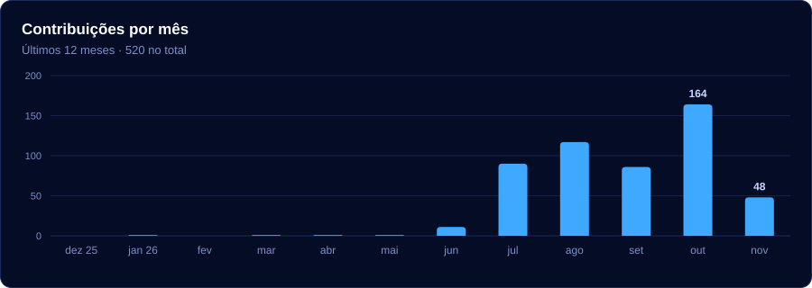
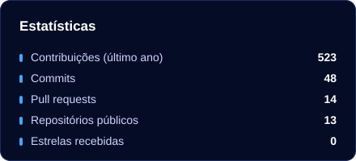
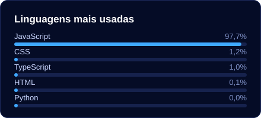

## Sobre mim

Sou desenvolvedor full-stack com foco em **TypeScript**. No back-end, construo APIs com **NestJS** e **PostgreSQL**; no front-end, trabalho com **Angular** e **React**. Gosto de projetos que transformam dados em informação útil.

## Contato

## Tecnologias

  

## Portfólio

| Nº | Projeto | Área | Principal tecnologia |
|:--:|---|---|---|
| 01 | **BetterFish** | Software empresarial | Next.js + Supabase |
| 02 | **[HypeX](https://github.com/DarknessBH/Hypex-Comentarios)** | Inteligência artificial | Next.js + Groq |
| 03 | **AgroTributos** | Fintech / Agronegócio | NestJS + Next.js |
| 04 | **[Austv / Altive](https://github.com/DarknessBH/AusTv)** | Game Server | Java + Paper |
| 05 | **Godzilla Mod** | Game Development | Java + GeckoLib |
| 06 | **Way Big Boss** | Game Development | Minecraft Modding |
| 07 | **Galvan (Mod)** | Game Development | Unreal Engine |
| 08 | **V.I.R.U.S.** | Inteligência artificial | Groq + n8n |
| 09 | **Bot Ben 10** | Automação / Discord | Discord API |
| 10 | **Controle de Piscicultura** | Gestão | AppSheet + Sheets |
| 11 | **Controle de Uniformes** | Software empresarial | Next.js + Supabase |
| 12 | **herick_gamer** | Criação de conteúdo | YouTube + IA |

## Estatísticas

  
   
  
  
   
  

